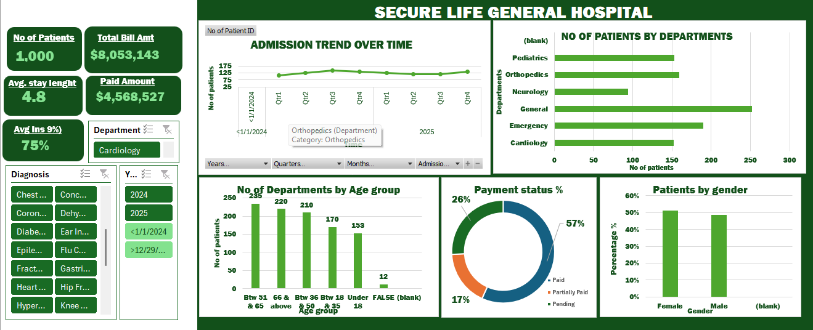

# -Operational-and-Financial-Performance-Analysis-for-Secure-Life-General-Hospital
## -Introduction 

In modern healthcare management, balancing patient care efficiency with sustainable revenue cycles is a paramount challenge. This report presents a strategic evaluation of Secure Life General Hospital by converting raw operational data into actionable management insights. By looking at patient paths, departmental workflows, and outstanding financial liabilities, this analysis establishes clear baselines to optimize resource allocation, enhance financial recovery, and improve the overall patient experience.

## About the Dataset
The underlying dataset consists of comprehensive clinical and financial transaction records from Secure Life General Hospital, tracking a cohort of 1,000 unique patient visits. The dataset bridges operational metrics with demographic and financial attributes across multiple fields:
- Operational Metrics: Patient ID, admitting department (e.g., General, Emergency, Orthopedics, Pediatrics, Neurology, Cardiology), and Length of Stay (LOS).
- Financial & Billing Records: Total billed amounts, payment status (Paid, Partially Paid, Pending), and insurance coverage percentages.
- Patient Demographics: Age brackets (ranging from under 18 to 66 & above) and gender tracking (Male, Female).
  Data used for the analyses [click here](https://drive.google.com/file/d/1Ypt_0NkqVO1Zs3nlrBeUWOd2J-IIUfYL/view?usp=classroom_web&authuser=0)
    

  
## Problem Statement
The management of Secure Life General Hospital observed noticeable shifts in patient admission volumes, accumulating outstanding medical bills, and variations in insurance coverage across clinical departments. The hospital lacked a unified, consolidated reporting system to monitor these changes. Without structural visibility, administration could not pinpoint bottlenecks in patient throughput, identify revenue leakage from unpaid bills, or understand which patient groups drive demand, leaving vital strategic choices to estimation rather than data.

## Visualization

Microsoft excel was used to design and develop this interactive dashboard for analizing operational and financial performance of secure life general hospital

## Data Insights 
Based on the performance metrics visualized in the interactive dashboard, the core findings are structured as follows:
### Operational Volume & Patient Throughput
- Total Volume: The hospital recorded exactly 1,000 patient visits.
- Departmental Demand: The General Medicine department received the highest number of patients (~250 visits), followed immediately by the Emergency department (~190 visits) and Orthopedics. Neurology holds the lowest patient volume among the major visible units.
- Length of Stay (LOS): The average length of stay across the facility sits at 4.8 days.
- Admission Trends Over Time: Patient admissions remain remarkably steady and flat throughout 2024 and 2025 across all four quarters, indicating regular, non-seasonal baseline demands on facility beds.
  ### Financial Metrics & Revenue Cycle
- Total Revenue Billed: The gross billings amounted to $8,053,143.
- Collections Breakdown:
o	Paid Amount: $4,568,527 has been successfully collected.
o	Payment Status %: 57% of patient accounts are fully paid, 17% are partially paid, and a significant 26% remain completely pending.
o	Outstanding Liabilities: A total of $3,484,616 remains outstanding in unpaid or partially paid accounts, showing a substantial liquidity backlog.
  ### Demographics & Insurance Dynamics
- Age Groups: The highest number of patient visits comes from the 51 to 65 age bracket (~235 visits), followed closely by senior citizens aged 66 and above (~220 visits) and individuals aged 36 to 50 (~210 visits). Pediatric and youth admissions are noticeably lower.
- Gender Distribution: The patient base is evenly split, with Females accounting for roughly 51% of visits and Males making up approximately 49%.
- Insurance Coverage: The average insurance coverage utilized across diagnostic groups is 75%

## Actionable Recommendations:
 ### Implement an Active Revenue Recovery Framework
With 26% of accounts entirely pending and over $3.48 million outstanding, management must minimize revenue leakage. The finance team should implement automated SMS/Email billing reminders, introduce flexible medical installment plans for the 17% who are "Partially Paid," and set up point-of-service financial counseling before discharge.
### Align Capacity with Age Demographics
Patients over the age of 51 account for nearly 45% of total hospital visits. Management should prioritize expanding geriatric specialized care, chronic disease management paths (e.g., for Diabetes and Hypertension noted in your filter pane), and post-discharge support to cater to this dominant demographic.
###  Optimize Bed Management and Throughput
Given an average length of stay of 4.8 days and high concentration in General and Emergency rooms, the hospital should initiate daily discharge rounds and establish transitional care coordinates to ensure efficient patient turnover without compromising health outcomes.
### Leverage Insurance Payer Relations
Since insurance covers an average of 75% of bills, the hospital must form closer partnerships with major insurance networks to clear administrative authorization bottlenecks, speeding up processing times for the large portion of pending accounts.

## Conclusion
The performance analysis for Secure Life General Hospital reveals a facility with robust, steady patient demand—particularly among aging demographics—but one that faces clear operational bottlenecks within its revenue cycle. While gross billings exceed $8.05 million, the underlying financial risk stems from the $3.48 million left uncollected. By executing focused revenue cycle management, adjusting clinical resources to match elder care requirements, and refining discharge workflows, the hospital can successfully bridge its operational performance gaps and safeguard its long-term financial health.

